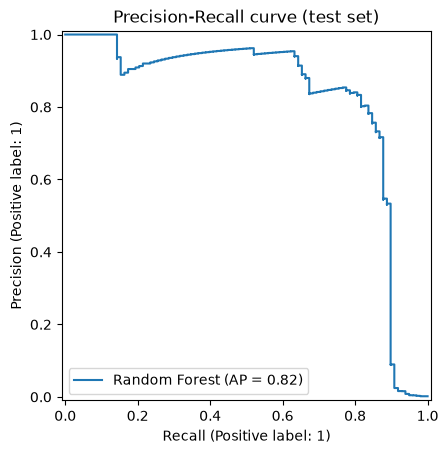
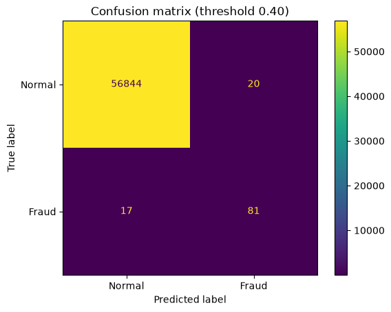
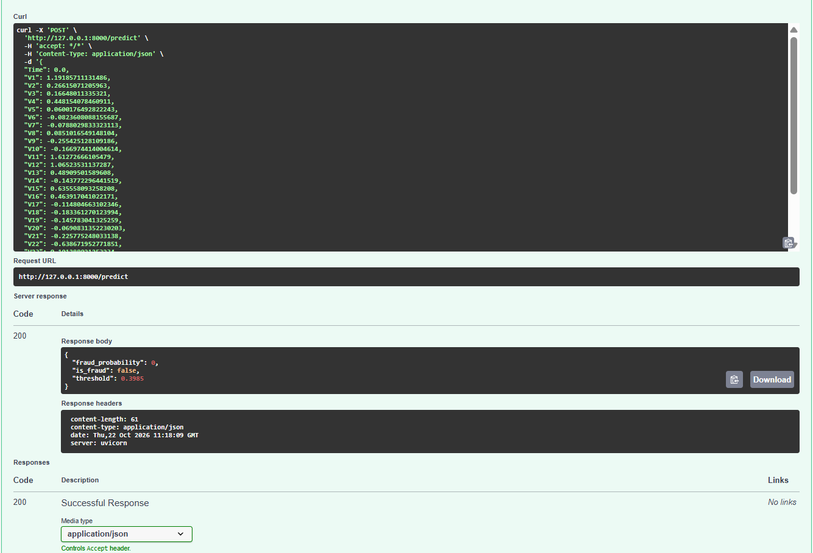
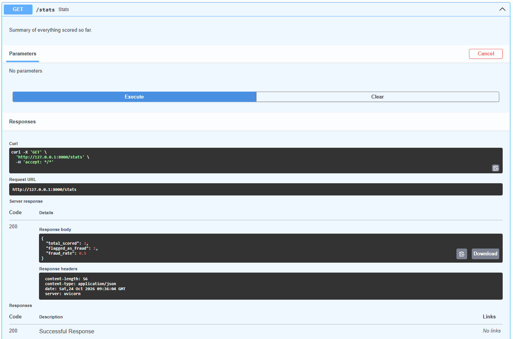
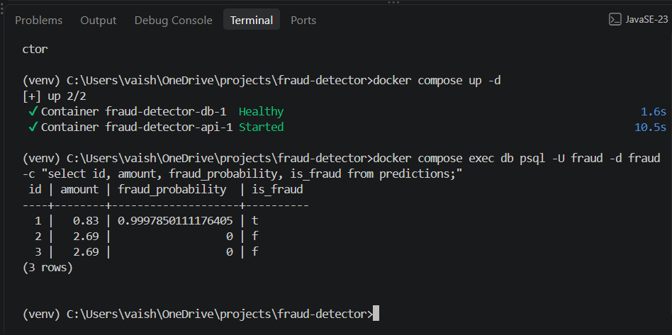

# 🕵️ Credit Card Fraud Detector

An end-to-end fraud detection project: a model trained on highly imbalanced data, served through a **FastAPI** prediction API, with every scored transaction stored in **PostgreSQL**, and the whole system packaged with **Docker Compose**.

Fraud is only about 0.17% of the transactions in this dataset, so the model is judged with precision, recall and PR-AUC, not accuracy.

## Problem

A model that labels every transaction "normal" is 99.8% accurate and catches no fraud at all. This project trains models that actually find the rare fraud cases, measures how many frauds are caught versus how many normal transactions are wrongly flagged, and exposes the model as a service that other programs can call.

## Dataset

[Credit Card Fraud Detection](https://www.kaggle.com/datasets/mlg-ulb/creditcardfraud) from Kaggle (Machine Learning Group, ULB): about 285,000 European card transactions from two days, of which 492 are fraud. Features `V1` to `V28` are anonymised (PCA-transformed), plus `Time` and `Amount`. The target column is `Class` (1 = fraud).

The CSV is not in this repo because of its size. Download it and place it at `data/creditcard.csv`.

## Model

1. **Split** the data into train, validation and test sets, keeping the same fraud ratio in each.
2. **Handle the imbalance** with class weights.
3. **Compare three models** on the validation set: Logistic Regression, Random Forest and Histogram Gradient Boosting.
4. **Select by PR-AUC**, the metric that suits rare events.
5. **Tune the decision threshold** on the validation set (best F1), instead of using 0.5.
6. **Evaluate once on the untouched test set.**

### Results (test set)

Best model: **Random Forest** (decision threshold 0.40)

| Metric | Value |
|---|---|
| Precision | 0.802 |
| Recall | 0.827 |
| F1 | 0.814 |
| PR-AUC | 0.821 |
| ROC-AUC | 0.966 |

Out of 98 frauds in the test set, the model **caught 81**, **missed 17**, and raised **20 false alarms**.




## API

`api.py` loads the saved model and serves it with FastAPI. Interactive documentation is at `/docs`.

| Endpoint | What it does |
|---|---|
| `POST /predict` | Scores one transaction and returns the fraud probability and a fraud / not-fraud decision. Invalid input (missing, extra or non-numeric fields) is rejected with a 422 error. |
| `GET /predictions` | The most recent scored transactions, newest first. |
| `GET /stats` | Total scored, number flagged as fraud, and the fraud rate. |
| `GET /health` | Confirms the service is running. |

Every call to `/predict` is saved in a database (`database.py`, SQLAlchemy). Locally it uses a SQLite file by default. Set the `DATABASE_URL` environment variable to use PostgreSQL, which is what Docker Compose does.

## Screenshots

> Check the file names in the `images` folder. Remove any line below whose image you do not have.





## Run it with Docker (API + PostgreSQL)

The trained model file is not stored in the repo, so train it first.

```bash
git clone https://github.com/vaishnavisnb/fraud-detector.git
cd fraud-detector

python -m venv venv
venv\Scripts\activate          # Windows
# source venv/bin/activate     # Mac/Linux
python -m pip install -r requirements.txt

# 1. put creditcard.csv in the data folder, then train the model
python train_fraud.py

# 2. write requirements-api.txt with the exact package versions used for training
#    (the saved model must be loaded with the same scikit-learn version)
python make_requirements.py

# 3. start the API and PostgreSQL together (Docker Desktop must be running)
docker compose up --build -d
```

Open `http://127.0.0.1:8000/docs`, try `POST /predict`, then check the stored rows:

```bash
docker compose exec db psql -U fraud -d fraud -c "select id, amount, fraud_probability, is_fraud from predictions;"
docker compose down            # stop (the data is kept in a Docker volume)
```

## Run it without Docker

```bash
python -m uvicorn api:app
```
Scored transactions are saved to a local `fraud.db` (SQLite).

## Tech stack

Python, pandas, scikit-learn, FastAPI, SQLAlchemy, PostgreSQL, Docker, Docker Compose

## Project structure

```
fraud-detector/
├── data/                   # creditcard.csv (download from Kaggle, not in the repo)
├── models/                 # saved model (created by train_fraud.py, not in the repo)
├── reports/                # metrics and charts
├── images/                 # screenshots
├── train_fraud.py          # training and evaluation
├── api.py                  # FastAPI prediction service
├── database.py             # database connection and table
├── make_sample.py          # creates example transactions for testing the API
├── make_requirements.py    # writes requirements-api.txt with exact versions
├── Dockerfile              # builds the API image
├── docker-compose.yml      # runs the API and PostgreSQL together
└── README.md
```

## Limitations and next steps

- The test set contains only 98 frauds, so the metrics move noticeably if a few cases change. Cross-validation would give a steadier estimate.
- The data covers two days of European transactions and the features are anonymised, so the model cannot explain why a transaction looks fraudulent.
- The database password in `docker-compose.yml` is a local demo default and should be changed for any real deployment.
- Next: automated tests for the API, a batch scoring endpoint, and monitoring how the fraud rate changes over time.

## Author

Vaishnavi · [GitHub](https://github.com/vaishnavisnb)
